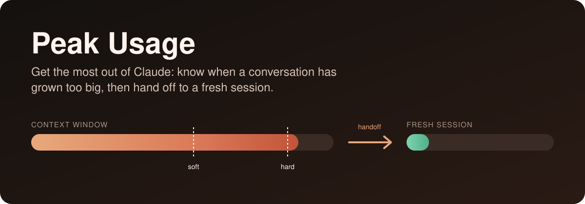
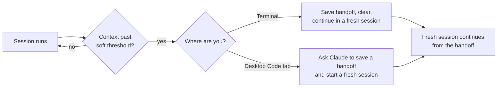

<p align="center">
  
</p>

<p align="center">
  <b>A Claude Code plugin that watches how big your conversation has grown and hands it off to a fresh session before output quality slips.</b>
</p>

<p align="center">
  <b>v1.3.2</b> &nbsp;·&nbsp; Claude Code 2.1.332+ &nbsp;·&nbsp; terminal, desktop Code tab, chat &amp; Cowork
</p>

---

## Why

Every turn re-reads the whole conversation. A long session costs more with each message, and past a point Claude also gets less precise: it loses an earlier correction, repeats finished work, or mixes up similar details. The usual fix is to notice by feel and start over by hand, losing the thread.

Peak Usage does the noticing for you, writes down what the next session needs, and continues from there.

## How it works



- **Measures real usage.** It reads actual token counts and the window size after each model step. No guessing from message count.
- **Soft threshold.** By default the lower of 65% of the window and 160,000 tokens. It looks for a natural break, not the middle of an edit.
- **Hard threshold.** 85% of the window. Reaching a safe checkpoint becomes the priority.
- **Measures growth, not the starting size.** A session begins with tools, skills and instructions already loaded. The plugin counts growth from the first reading, so it does not fire on the first message.
- **Stays out of the way.** It skips the handoff when the task is nearly done, work is in flight, or Claude is waiting on you.

## Where it works

| Surface | What happens at the threshold |
| --- | --- |
| **Claude Code terminal** | Automatic rollover: saves a checkpoint, runs `/clear`, and seeds the fresh session with the handoff. The old chat stays available in `/resume`. |
| **Desktop app, Code tab** | `nudge` mode: the plugin adds a note to a tool result asking Claude to save a handoff and start a fresh session with the app's own session tool. That tool may need one click from you. |
| **Claude chat and Cowork** | No monitoring. Run the handoff skill to get a downloadable `peak-handoff.md` to attach to a new chat. |

## Install

**Claude Code terminal** (needs 2.1.275 or later for marketplace install):

```text
/plugin install peakusage --marketplace DarkPromo/Claude-Peak-usage
```

**Desktop app or Claude chat:** download `peakusage-1.3.2.zip` from the [latest release](https://github.com/DarkPromo/Claude-Peak-usage/releases/latest) and use **Customize > Plugins > Add > Upload plugin**. Remove an older copy first so two copies do not run side by side.

**From a local folder:**

```powershell
claude --plugin-dir "C:\path\to\Claude-Peak-usage\peakusage"
```

Check that it is running with `/peak-usage status`.

## Commands

| Command | What it does |
| --- | --- |
| `/peak-usage status` | Show the mode, context size, thresholds and the last decision. |
| `/peak-usage start [auto\|suggest]` | Start monitoring now (only needed when autostart is off). |
| `/peak-usage stop` | Pause monitoring for this session. |
| `/peak-usage recover <session-id>` | Show a saved checkpoint. |
| `/peakusage:handoff` | Save `peak-handoff.md` in the workspace and keep the session open. Works on every surface. |
| `/peakusage:peak-compact` | The same handoff, also triggered by phrases like "checkpoint this" or "continue in a new chat". |
| `/peakusage:peak-usage-guide` | Usage-saving habits and settings help. |

## Settings

Change these in Claude Code's `/config`.

| Setting | Default | Effect |
| --- | --- | --- |
| Start monitoring automatically | `on` | `off` waits for `/peak-usage start`. |
| Rollover mode | `auto` | `suggest` prepares a checkpoint without clearing. Terminal only. |
| Soft context percentage | `65` | Consider a handoff at the lower of this percentage and the token cap. |
| Soft token cap | `160000` | `0` removes the cap. Raise it if you routinely work well past 160k. |
| Hard context percentage | `85` | Prioritize reaching a safe checkpoint. |
| Skill restoration | `relevant` | `allowlist` or `none` limit which earlier skills carry over. |

## What a handoff contains

A short Markdown file, about 700 to 1,200 tokens, with only what the next session needs: the goal and acceptance criteria, the constraints you stated in your own words, verified progress and test results, files and links to point at, pending work, actions that must not be repeated, and the first next step. It anchors to real state (branch, HEAD, uncommitted files) and leaves out secrets.

## Beyond rollover

The guide skill also teaches Claude the habits that save usage inside a session: narrow reads instead of whole files, bounded command output, no re-reading, batched tool calls, subagents for broad searches, and when to suggest `/clear`, `/compact` with a focus, or a handoff. See [the efficiency playbook](peakusage/skills/peak-usage-guide/references/efficiency.md).

## Status and limits

- **Tested:** the plugin validates with `claude plugin validate`, and its desktop nudge logic has mock-event tests (`claude plugin test`).
- **Observed live:** in the desktop Code tab, a plugin note reaches Claude through a tool result, and token counts and the window size are readable.
- **Not yet confirmed end to end:** a real long session in which the nudge fires and Claude starts the fresh session. Terminal auto-rollover comes from the original plugin and was not re-run live in this version.
- The desktop nudge arrives with tool calls, so a reply with no tool calls gets none.
- The research notes in [`context-research.md`](peakusage/skills/peak-usage-guide/references/context-research.md) cite third-party papers and vendor documents that were not independently re-checked. The default thresholds are starting points to tune against your own work, not proven optima.

## Layout

```text
.claude-plugin/marketplace.json   marketplace listing
peakusage/                        the plugin
  .claude-plugin/plugin.json      manifest and settings
  hooks/                          monitoring, thresholds, handoff and rollover logic
  skills/                         handoff, peak-compact, peak-usage-guide
assets/banner.svg                 banner used above
```

## License

[MIT](LICENSE)
